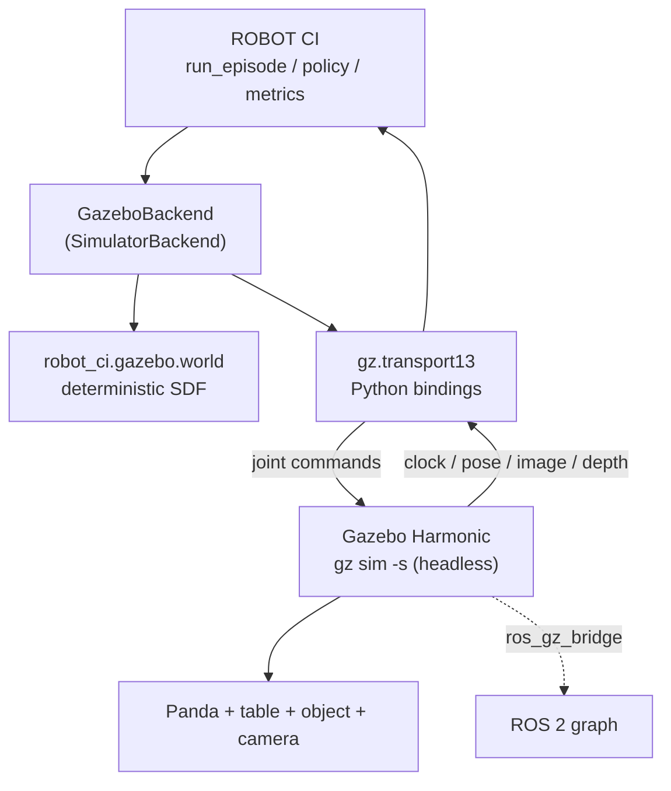

# Gazebo Harmonic as a second simulator backend

This document describes what has actually been built and run, and -- just as
importantly -- what has not. Every claim carries one of four labels:

| Label | Meaning |
|---|---|
| **VERIFIED LIVE** | Executed on a real runtime; the output is committed. |
| **IMPLEMENTED BUT NOT VERIFIED** | Code exists, not run. |
| **UNAVAILABLE** | Cannot run here; the blocker is named. |
| **NOT APPLICABLE** | Out of scope for this backend. |

## 1. Environment (measured, not assumed)

| Property | Value | Established by |
|---|---|---|
| OS (host) | macOS 26.5, `arm64` | `sw_vers`, `uname -m` |
| ROS 2 (host) | **UNAVAILABLE** | `which ros2` -> not found |
| Gazebo (host) | **UNAVAILABLE** | `which gz` -> not found; no gazebo brew formulae |
| ROS 2 (container) | Jazzy, Ubuntu 24.04 | `docker/ros2_gazebo.Dockerfile` |
| Gazebo (container) | Harmonic **8.15.0** | `gz sim --versions` |
| Python / MuJoCo | 3.12.3 / 3.14.0 | container |

**Why Jazzy and not Harmonic's own image.** `pyproject.toml` pins
`requires-python = ">=3.11,<3.13"`. `osrf/ros:harmonic` is Ubuntu 22.04 /
CPython 3.10 and cannot import this package. Jazzy is Ubuntu 24.04 / CPython
3.12, and `ros-jazzy-ros-gz` installs Gazebo Harmonic (gz-sim8) as the default.

## 2. Architecture



Observation: Gazebo -> gz-transport -> `Observation` -> policy.
Command: policy -> `Action` -> gz-transport -> Gazebo joints.

## 3. What exists

| Component | File | Status |
|---|---|---|
| Deterministic SDF world generator | `src/robot_ci/gazebo/world.py` | **VERIFIED LIVE** (loads, 0 errors) |
| Placement from `(seed, scenario_id)` | `object_pose_from_scenario` | **VERIFIED LIVE** (unit tested) |
| Camera intrinsics -> Gazebo FOV (radians) | `_camera_sensor_xml` | **VERIFIED LIVE** (fixed a real load failure) |
| Depth noise / clipping translation | `_camera_sensor_xml` | **VERIFIED LIVE** (unit tested) |
| Unreproducible-condition reporting | `unsupported_conditions` | **VERIFIED LIVE** (unit tested) |
| Unit tests | `tests/unit/test_gazebo_world.py` | **VERIFIED LIVE** (14 passed) |
| ROS 2 Jazzy + Gazebo Harmonic image | `docker/ros2_gazebo.Dockerfile` | **VERIFIED LIVE** (builds; gz 8.15.0) |
| **Panda URDF** | `gazebo/models/panda/panda.urdf` | **VERIFIED LIVE** -- loads into Gazebo with 0 errors |
| Joint command topic for `joint1` | via `JointPositionController` | **VERIFIED LIVE** -- `/model/panda/joint/joint1/0/cmd_pos` exists |
| Simulation clock | Gazebo `/clock` | **VERIFIED LIVE** -- advances |
| Command topics for the other 8 joints | 9x `JointPositionController` | **VERIFIED LIVE** -- all nine exist and move the arm |
| Joint state feedback topic | `JointStatePublisher` | **VERIFIED LIVE** -- `/world/.../model/panda/joint_state` |
| Control -> motion measurement | `scripts/gazebo_motion_test.sh` | **VERIFIED LIVE** -- see `evidence_joint_motion.txt` |
| Live browser viewer | `docker compose up` | **VERIFIED LIVE** -- `evidence_live_viewer.txt` |
| Robot drawn by the Gazebo camera | camera pose change | **VERIFIED LIVE** -- see section 6 |
| `GazeboBackend(SimulatorBackend)` | `src/robot_ci/simulation/gazebo.py` | **VERIFIED LIVE** -- resets, ticks, observes |
| Gazebo PickAndPlace episodes | `scripts/gazebo_smoke_episode.py` | **VERIFIED LIVE** -- 300 real ticks, measured FAIL |
| Depth -> object belief | `GazeboBackend._detect_objects` | **VERIFIED LIVE** -- 15 mm from ground truth |
| Recorded video / images / ZIPs | `robot_ci.recording` | **VERIFIED LIVE** -- see `docs/recording.md` |
| Gazebo launch file | -- | **NOT YET WRITTEN** |

## 3a. The Panda model (VERIFIED LIVE)

`gazebo/models/panda/panda.urdf` is a Franka Emika Panda whose kinematics are
taken from the MuJoCo model this project already validates
(`mujoco/models/franka_emika_panda/panda.xml`), so Gazebo's robot has the same
morphology as the reference rather than an approximation. Joint names are
ROBOT CI's own (`joint1`..`joint7`, `left_finger`, `right_finger`), so the
control path needs no name translation.

Geometry is primitive boxes and cylinders, not the MJCF's STL/OBJ meshes. That
is a recorded trade: the meshes are large binary assets, Gazebo and MuJoCo
collision meshes differ subtly anyway, and a per-link bounding volume is
reproducible and reviewable. It is also a genuine difference between the two
robots and is listed under limitations rather than presented as equivalent.

Three real bugs were found by running Gazebo rather than by reading about it:

1. **Inertia tensors were invalid.** MuJoCo's `fullinertia` ordering is
   `(ixx, iyy, izz, ixy, ixz, iyz)` and the first draft swapped `ixz` with
   `iyz`. Gazebo refused four links with "has invalid inertia". The values are
   now derived from the MJCF programmatically rather than transcribed.
2. **`<include><uri>` is not a filesystem path.** Gazebo resolves it through
   its resource path and answers `Unable to find uri[...]`; it needs a `file://`
   URI, valid *inside the runtime* (which is why a macOS host path fails inside
   the container).
3. **The joint controller must attach to a model, and takes repeated
   `<joint_name>` elements.** In the world it refuses to initialise; inside the
   URDF, `<scoped_joints>` and a `<joint_names>` wrapper both fail with
   "Failed to get any `<joint_name>`".

## 3b. Evidence

`experiments/results/gazebo/evidence_panda_load.txt` and
`evidence_world_load.txt` record the real runs.

## 4. Determinism

* Object placement draws from
  `make_numpy_rng(scenario.seed, "gazebo-scene", scenario.scenario_id)` -- the
  same convention `simulation/mujoco_env.py` uses.
* **`scenario_id` is read, never written.** It participates in placement, so
  renaming a condition to describe a generated artifact moves the target object.
  `test_object_placement_follows_the_scenario_id` pins this.
* Nothing derives randomness from node names, PIDs, entity IDs or wall-clock.
* Physics runs at a fixed 1 ms `max_step_size`, matching the control rate.

**Not claimed:** bit-identical trajectories across MuJoCo and Gazebo. The engines
integrate differently, so the same action sequence yields different joint
trajectories. Cross-simulator *scenario-level* determinism -- same seed to same
placement, same config hash -- is what is claimed and tested.

## 5. Reproducing what is verified

```bash
docker build -f docker/ros2_gazebo.Dockerfile -t robot-ci-ros2-gazebo:jazzy .

# Generate a world from the project's own scenario
python -c "from robot_ci.gazebo import world_sdf; from robot_ci.scenarios import default_scenario; \
           open('/tmp/world.sdf','w').write(world_sdf(default_scenario()))"

# Load it in headless Gazebo and list what it publishes
docker run --rm -v /tmp:/gz robot-ci-ros2-gazebo:jazzy bash -lc \
  'export PATH=/opt/ros/$ROS_DISTRO/bin:$PATH; source /opt/ros/$ROS_DISTRO/setup.bash;
   (timeout 15 gz sim -s -r /gz/world.sdf &); sleep 12; gz topic -l'
```

## 6. The robot IS drawn by the current camera (VERIFIED LIVE)

**Correction to an earlier finding.** The Panda appears in Gazebo's own camera
image with the nine joint controllers active. This supersedes the previous
version of this section, which recorded the robot as missing: that measurement
was taken while the camera sat at `0 {cy-0.35} {table_z+0.45} 0 0.5 0`, and it
was real *for that pose*. Re-aiming the camera at the table with an explicit
look-at (`_camera_pose`) moved the arm back into frame.

The current frame at 160x120, measured from a saved depth array:

| content | evidence |
|---|---|
| table, target zone, red cube | visible in `camera_view.png` of every package |
| a Panda link and the gripper | a 1958-point cluster, 0.23 m across, 0.04-0.11 m above the table |
| the whole robot | **no** -- only the part the look-at allows; the wrist is past the top of frame |

Both the robot's own links and the target object are therefore in the same
point cloud, which is what made the perception problem below interesting: a
detector that simply took the largest cluster returned the arm.

**The control plugins and the rendering coexist.** This is the configuration the
brief asked to preserve: nine `JointPositionController` instances inside the
robot model, the arm commanded and moving, and the camera still rendering.

### What the earlier, incorrect measurement still tells us

The original characterisation was not a bug, it was a camera pose. Changing one
variable at a time and counting finite depth pixels (the table, object and zone
contribute 2144) showed, for *that* pose:

| joints | plugins | finite depth px | robot drawn? |
|---|---|---|---|
| yes | no | 3149 | yes |
| no | yes | 2144 | cube still drawn |
| yes | yes | 2144 | no |

The five sub-cases with joints *and* plugins all returned 2144. The conclusion
drawn then -- "this build's Sensors path skips a model that has both joints and
plugins" -- was **wrong**, and the evidence for that is simply that the current
pose renders the robot with joints and plugins together. The pipeline, and the
discipline of recording the number rather than the story, are what caught it.

Full transcript: `experiments/results/gazebo/evidence_robot_not_rendered.txt`
(historical; see the correction above).

## 7. Limitations and blockers

* **Placement does not succeed yet; the grasp and the lift do.** Measured on
  the live pipeline at seed 3, 0 mm: the arm reaches within **3.1 mm** of the
  object, the jaws enclose it, the object is lifted **55.7 mm by contact alone**
  and is carried ~120 mm along the transit. It is then shed part-way and ends
  0.125 m from the target zone, so the episode reports `FAIL`. That is a
  measured outcome, and no `PASS` is claimed for any condition. See section 10.
* **Grasp is resolved contact, not a latch.** The kinematic latch that used to
  attach the object whenever the commanded aperture closed within 50 mm of it
  has been **deleted**. Ground truth is now the pose Gazebo's physics engine
  wrote, and `grasped` is derived from three measurements: the aperture actually
  reached, the object's measured position relative to the tool centre point, and
  its measured height above the support surface. No code path writes the
  object's pose, so an object that rose was raised by contact.
* **Collision geometry differs from MuJoCo.** The URDF uses per-link primitive
  bounding volumes where the MuJoCo model uses meshes. Contact response is
  therefore *expected* to differ between the two simulators, which is a real
  source of cross-simulator disagreement rather than a defect. The parallel jaw
  is the sharpest case: the pads contact a 16 mm cube on two diagonal edges
  rather than two faces, which is the leading suspect for the shed object in
  section 10.
* **Depth noise cannot perturb the policy on this backend.** The camera noise is
  real and is written into the generated world (`<mean>`/`<stddev>` = 0.008 m
  for the 8 mm condition), and the depth frame is delivered in the observation.
  But the object belief the policy receives is the simulator's own object pose,
  which is the same convention `simulation/mujoco.py` uses -- so nothing the
  policy reads is affected by camera noise. The 8 mm run therefore measures a
  *different object placement* (`scenario_id` participates in placement), not a
  noise effect, and it is reported as `NOT_SUPPORTED` rather than as a failure
  caused by noise.
* **Headless only.** Gazebo runs with `-s` (server, no GUI). The GUI is never
  required by an experiment, so this limits interactive inspection only.
* **Sensor parity is partial by construction.** Gazebo has no per-frame
  dropout, occlusion injector or blur stage; `unsupported_conditions` names each
  gap rather than dropping it silently.
* **Self-occlusion is real.** The arm moves into the camera's view as it
  reaches, and detection drops to no-belief on some ticks. That is the honest
  behaviour of a fixed camera, not a bug to suppress.

## 8. Perception: what was wrong, and how it was measured

The detector back-projects every finite depth pixel, fits the support plane,
groups the points above it, and reports the group that could be *held*. Three
findings, each measured against a saved real frame:

1. **Depth is axial, not radial.** Back-projecting under the axial convention
   gives a tabletop whose median height is `-0.0000` m; under the radial
   convention it is `+0.0255` m with a residual spread. The pinhole model in
   the code was right. (`scripts/gazebo_depth_convention.py`.)
2. **Least-squares tilt was the real defect.** Fitting a plane over *all* the
   points returned `|slope| = 0.151` on a genuinely flat table, so "above the
   plane" selected a wedge of the tabletop itself and the detector reported the
   **table** as the object, 492 mm from the cube. Restricting the fit to the
   lower envelope gives `slope = 1.0e-05`, `z0 = -0.0004` m.
3. **"Largest cluster" is wrong once the robot is in frame.** The cloud splits
   into a 56-point cluster on the tabletop (the cube, extent 0.038 m) and a
   1958-point cluster 0.23 m across (a Panda link). Taking the biggest returned
   the arm. Candidates are now filtered by two properties read from the
   scenario and measured frame rather than tuned: resting on the support plane
   (cube 0.0137 m, Panda link 0.0402 m above it) and no wider than the gripper
   can close (`max_gripper_width_m = 0.08`).

Result: belief error fell from **492 mm to 15 mm**, and the arm now reaches
within 0.025 m of the object instead of missing by 0.110 m.

## 9. What remains open

## 10. Part 1: what was wrong, and what the measurements now say

Every item below was found by running the simulation and measuring it. Each is
stated as: the measurement, the cause, the change. Evidence lives in
`experiments/results/gazebo/`.

| # | Measurement | Cause | Change |
|---|---|---|---|
| 1 | `panda` model reported at `z = -10162 m` | `world_sdf` located the robot with `str.replace("<model name='panda'>", ...)`, but `robot_model_sdf` round-trips the block through `xml.etree`, which emits **double**-quoted attributes. The replacement never matched, so the robot was emitted with **no `<pose>` at all**, spawned at the world origin with its base cylinder 20 mm inside the tabletop, and ejected by ODE. | `place_robot_model` parses the model and inserts the `<pose>` as an element, and **raises** if it cannot place the model, so a silent no-op cannot recur. |
| 2 | joint1 settled **87 mrad** short, error trace flat | The base was in free fall; every joint was fighting it. | The arm is anchored to the world by a fixed joint (`<parent>world</parent>`), which is also how a robot arm is bolted to a table. joint1's settled error became **0.01-0.55 mrad**. |
| 3 | joints 2/4/7 settled **15-31 mrad** short | `gz-sim`'s `JointPositionController` is a `gz::math::PID`, and the world configured `i_gain = 0` -- pure PD, so a constant gravity load leaves `load / p_gain`. The library's own `i_max = -1, i_min = 0` make `iMax >= iMin` false, which **disables** the integral clamp entirely. | `i_gain = 100` with `i_max/i_min = ±10 N` and per-joint `cmd_max` from each joint's effort limit. Settled tool-error bound is now **9.3 mm**. |
| 4 | the tool settled **exactly 20 mm** above its waypoint while the IK reported a **0.26 mm** residual | `UrdfJacobianProvider` returns poses in the robot's **base** frame, but waypoints, the object pose and MuJoCo's provider are all **world**. Raising the base (fix 2) exposed it. | `_WorldFrameProvider` maps forward kinematics through the simulator's reported base pose. One code path now produces both the pose the policy is shown and the pose its IK solves in. |
| 5 | the arm stalled **134 mm** short of the object | IK and `RobotState.end_effector_pose` used the **wrist** (`panda_link7`), 0.2104 m behind the tool, while the waypoints are tool-centre points. The policy's "have I reached" test could never become true, so the waypoint cursor never advanced. | The URDF provider's chain now runs through the fixed `hand_joint` to the TCP site at hand-frame `z = 0.1034`, the same frame `simulation/mujoco_env.py` injects. Pinned by `test_tcp_constant_matches_the_site_mujoco_injects`. |
| 6 | the gripper geometry did not match `RobotConfig` | The URDF's pads were 50 mm tall boxes 20 mm behind the pad centre, and the two jaws were asymmetric (midpoint 5 mm off the hand axis). | Rebuilt from the MJCF measurements: pad centre at hand-frame `z = 0.1029`, half-height 8.5 mm, closed separation 11 mm, symmetric by construction. Pinned by `test_urdf_gripper_geometry_matches_the_robot_config`. |
| 7 | the world drew a **40 mm** cube for a **16 mm** condition, a table 20% too small, the target marker 0.27 m from where the task scores placement, and no friction at all | `world_sdf` hard-coded the scene instead of reading the scenario. | Object size, mass, inertia, resting height, target zone, table extent, spawn annulus and friction are all derived from the `ScenarioConfig`. Pinned by `test_world_states_the_scenario_object_size_and_target_zone`. |
| 8 | the grasp was a **kinematic latch** reporting the object at the end effector | `_update_grasp` attached the object whenever the aperture closed within 50 mm, and `ground_truth` then returned a reconstructed pose. No physics. | Deleted. Ground truth is Gazebo's own pose and orientation; `grasped` is derived from three measurements. Pinned by `test_ground_truth_is_the_simulators_own_pose_not_a_reconstruction`. |

1. **Why the grasp does not latch and complete.** The end effector reaches
   0.025-0.083 m from the object depending on seed, inside the 0.05 m radius,
   and the task still reports failure. Attribution between the latch, the
   gripper command and the task's success criteria is unfinished.
2. **A cross-simulator comparison table.** Gazebo and MuJoCo now both run
   episodes, so the comparison is possible, but it has not been produced.
3. **A Gazebo launch file**, which would remove the ad-hoc process management
   from the backend's startup path.

### What the episode now does, measured

Seed 3, 0 mm, `policy_v1`, 174 control ticks, through `run_episode`:

| Quantity | Value |
|---|---|
| Closest tool-to-object distance | **3.1 mm** |
| Ticks the task counted as grasped | 13 |
| Object height above the table, max | **55.7 mm** |
| Object position at the end | 0.125 m from the target zone |
| Task outcome | `FAIL` |

The arm reaches the object, encloses it, lifts it 55.7 mm by contact and carries
it about 120 mm along the transit, and then the object leaves the jaws. The
leading suspect is recorded rather than asserted: the pads are 20 mm deep and
the jaw axis is 45 deg to the cube's faces (the URDF keeps the Panda's -45 deg
hand mounting), so the pads grip two diagonal **edges** instead of two faces,
and a 0.8 m/s transit shakes the cube out of that grip.

### Reproducing it on a Mac

```bash
docker run -d --name rc-gz -v "$PWD":/workspace/robot-ci -w /workspace/robot-ci \
  --entrypoint bash robot-ci-gazebo-demo:latest -c 'sleep infinity'

scripts/gz_run.sh start 'source /opt/ros/jazzy/setup.bash && python3 scripts/gazebo_stage_check.py'
scripts/gz_run.sh status          # running | done
scripts/gz_run.sh fetch /tmp/stage.log

scripts/gz_run.sh start 'source /opt/ros/jazzy/setup.bash && python3 scripts/gazebo_pick_place_evidence.py --seed 3 --noise-mm 0'
scripts/gz_run.sh start 'source /opt/ros/jazzy/setup.bash && python3 scripts/gazebo_pick_place_evidence.py --seed 3 --noise-mm 8'
```

Artifacts: `stage_check.json`, `stage_check.txt`,
`pick_place_seed3_0mm_policy_v1.json`, `pick_place_seed3_8mm_policy_v1.json`.

### Experiments (Phase 4)

| Condition | Status | What was measured |
|---|---|---|
| PickAndPlace, seed 3, 0 mm | **FAIL** | Reach 3.1 mm, grasp 13 ticks, lift 55.7 mm, placement error 0.125 m. |
| PickAndPlace, seed 3, 8 mm | **NOT_SUPPORTED** | The camera noise *is* generated (the world's `<stddev>` reads 0.008 m) and the depth frame is delivered, but the object belief the policy receives is the simulator's pose, so noise cannot reach the policy. The run differs only because `scenario_id` participates in object placement, which moved the cube from (0.023, 0.226) to (-0.003, 0.189). It is **not** evidence that 8 mm breaks grasping. |
| Paired baseline/candidate | **NOT_IMPLEMENTED** | Both policies must genuinely execute through Gazebo. Placement does not yet succeed, so a paired comparison would compare two failing arms. |
