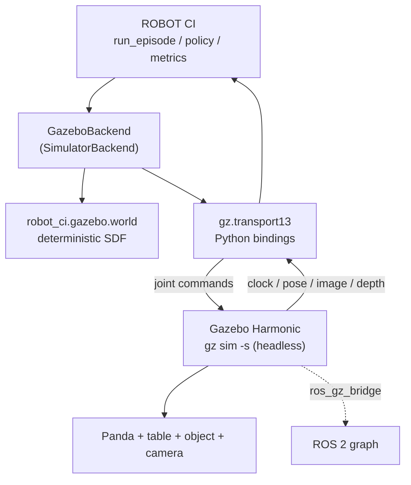

# Gazebo Harmonic as a second simulator backend

This document describes what has actually been built and run, and -- just as
importantly -- what has not. Every claim carries one of four labels:

| Label | Meaning |
|---|---|
| **VERIFIED LIVE** | Executed on a real runtime; the output is committed. |
| **IMPLEMENTED BUT NOT VERIFIED** | Code exists, not run. |
| **UNAVAILABLE** | Cannot run here; the blocker is named. |
| **NOT APPLICABLE** | Out of scope for this backend. |

## 1. Environment (measured, not assumed)

| Property | Value | Established by |
|---|---|---|
| OS (host) | macOS 26.5, `arm64` | `sw_vers`, `uname -m` |
| ROS 2 (host) | **UNAVAILABLE** | `which ros2` -> not found |
| Gazebo (host) | **UNAVAILABLE** | `which gz` -> not found; no gazebo brew formulae |
| ROS 2 (container) | Jazzy, Ubuntu 24.04 | `docker/ros2_gazebo.Dockerfile` |
| Gazebo (container) | Harmonic **8.15.0** | `gz sim --versions` |
| Python / MuJoCo | 3.12.3 / 3.14.0 | container |

**Why Jazzy and not Harmonic's own image.** `pyproject.toml` pins
`requires-python = ">=3.11,<3.13"`. `osrf/ros:harmonic` is Ubuntu 22.04 /
CPython 3.10 and cannot import this package. Jazzy is Ubuntu 24.04 / CPython
3.12, and `ros-jazzy-ros-gz` installs Gazebo Harmonic (gz-sim8) as the default.

## 2. Architecture



Observation: Gazebo -> gz-transport -> `Observation` -> policy.
Command: policy -> `Action` -> gz-transport -> Gazebo joints.

## 3. What exists

| Component | File | Status |
|---|---|---|
| Deterministic SDF world generator | `src/robot_ci/gazebo/world.py` | **VERIFIED LIVE** (loads, 0 errors) |
| Placement from `(seed, scenario_id)` | `object_pose_from_scenario` | **VERIFIED LIVE** (unit tested) |
| Camera intrinsics -> Gazebo FOV (radians) | `_camera_sensor_xml` | **VERIFIED LIVE** (fixed a real load failure) |
| Depth noise / clipping translation | `_camera_sensor_xml` | **VERIFIED LIVE** (unit tested) |
| Unreproducible-condition reporting | `unsupported_conditions` | **VERIFIED LIVE** (unit tested) |
| Unit tests | `tests/unit/test_gazebo_world.py` | **VERIFIED LIVE** (14 passed) |
| ROS 2 Jazzy + Gazebo Harmonic image | `docker/ros2_gazebo.Dockerfile` | **VERIFIED LIVE** (builds; gz 8.15.0) |
| **Panda URDF** | `gazebo/models/panda/panda.urdf` | **VERIFIED LIVE** -- loads into Gazebo with 0 errors |
| Joint command topic for `joint1` | via `JointPositionController` | **VERIFIED LIVE** -- `/model/panda/joint/joint1/0/cmd_pos` exists |
| Simulation clock | Gazebo `/clock` | **VERIFIED LIVE** -- advances |
| Command topics for the other 8 joints | 9x `JointPositionController` | **VERIFIED LIVE** -- all nine exist and move the arm |
| Joint state feedback topic | `JointStatePublisher` | **VERIFIED LIVE** -- `/world/.../model/panda/joint_state` |
| Control -> motion measurement | `scripts/gazebo_motion_test.sh` | **VERIFIED LIVE** -- see `evidence_joint_motion.txt` |
| Live browser viewer | `docker compose up` | **VERIFIED LIVE** -- `evidence_live_viewer.txt` |
| Robot drawn by the Gazebo camera | camera pose change | **VERIFIED LIVE** -- see section 6 |
| `GazeboBackend(SimulatorBackend)` | `src/robot_ci/simulation/gazebo.py` | **VERIFIED LIVE** -- resets, ticks, observes |
| Gazebo PickAndPlace episodes | `scripts/gazebo_smoke_episode.py` | **VERIFIED LIVE** -- 300 real ticks, measured FAIL |
| Depth -> object belief | `GazeboBackend._detect_objects` | **VERIFIED LIVE** -- 15 mm from ground truth |
| Recorded video / images / ZIPs | `robot_ci.recording` | **VERIFIED LIVE** -- see `docs/recording.md` |
| Gazebo launch file | -- | **NOT YET WRITTEN** |

## 3a. The Panda model (VERIFIED LIVE)

`gazebo/models/panda/panda.urdf` is a Franka Emika Panda whose kinematics are
taken from the MuJoCo model this project already validates
(`mujoco/models/franka_emika_panda/panda.xml`), so Gazebo's robot has the same
morphology as the reference rather than an approximation. Joint names are
ROBOT CI's own (`joint1`..`joint7`, `left_finger`, `right_finger`), so the
control path needs no name translation.

Geometry is primitive boxes and cylinders, not the MJCF's STL/OBJ meshes. That
is a recorded trade: the meshes are large binary assets, Gazebo and MuJoCo
collision meshes differ subtly anyway, and a per-link bounding volume is
reproducible and reviewable. It is also a genuine difference between the two
robots and is listed under limitations rather than presented as equivalent.

Three real bugs were found by running Gazebo rather than by reading about it:

1. **Inertia tensors were invalid.** MuJoCo's `fullinertia` ordering is
   `(ixx, iyy, izz, ixy, ixz, iyz)` and the first draft swapped `ixz` with
   `iyz`. Gazebo refused four links with "has invalid inertia". The values are
   now derived from the MJCF programmatically rather than transcribed.
2. **`<include><uri>` is not a filesystem path.** Gazebo resolves it through
   its resource path and answers `Unable to find uri[...]`; it needs a `file://`
   URI, valid *inside the runtime* (which is why a macOS host path fails inside
   the container).
3. **The joint controller must attach to a model, and takes repeated
   `<joint_name>` elements.** In the world it refuses to initialise; inside the
   URDF, `<scoped_joints>` and a `<joint_names>` wrapper both fail with
   "Failed to get any `<joint_name>`".

## 3b. Evidence

`experiments/results/gazebo/evidence_panda_load.txt` and
`evidence_world_load.txt` record the real runs.

## 4. Determinism

* Object placement draws from
  `make_numpy_rng(scenario.seed, "gazebo-scene", scenario.scenario_id)` -- the
  same convention `simulation/mujoco_env.py` uses.
* **`scenario_id` is read, never written.** It participates in placement, so
  renaming a condition to describe a generated artifact moves the target object.
  `test_object_placement_follows_the_scenario_id` pins this.
* Nothing derives randomness from node names, PIDs, entity IDs or wall-clock.
* Physics runs at a fixed 1 ms `max_step_size`, matching the control rate.

**Not claimed:** bit-identical trajectories across MuJoCo and Gazebo. The engines
integrate differently, so the same action sequence yields different joint
trajectories. Cross-simulator *scenario-level* determinism -- same seed to same
placement, same config hash -- is what is claimed and tested.

## 5. Reproducing what is verified

```bash
docker build -f docker/ros2_gazebo.Dockerfile -t robot-ci-ros2-gazebo:jazzy .

# Generate a world from the project's own scenario
python -c "from robot_ci.gazebo import world_sdf; from robot_ci.scenarios import default_scenario; \
           open('/tmp/world.sdf','w').write(world_sdf(default_scenario()))"

# Load it in headless Gazebo and list what it publishes
docker run --rm -v /tmp:/gz robot-ci-ros2-gazebo:jazzy bash -lc \
  'export PATH=/opt/ros/$ROS_DISTRO/bin:$PATH; source /opt/ros/$ROS_DISTRO/setup.bash;
   (timeout 15 gz sim -s -r /gz/world.sdf &); sleep 12; gz topic -l'
```

## 6. The robot IS drawn by the current camera (VERIFIED LIVE)

**Correction to an earlier finding.** The Panda appears in Gazebo's own camera
image with the nine joint controllers active. This supersedes the previous
version of this section, which recorded the robot as missing: that measurement
was taken while the camera sat at `0 {cy-0.35} {table_z+0.45} 0 0.5 0`, and it
was real *for that pose*. Re-aiming the camera at the table with an explicit
look-at (`_camera_pose`) moved the arm back into frame.

The current frame at 160x120, measured from a saved depth array:

| content | evidence |
|---|---|
| table, target zone, red cube | visible in `camera_view.png` of every package |
| a Panda link and the gripper | a 1958-point cluster, 0.23 m across, 0.04-0.11 m above the table |
| the whole robot | **no** -- only the part the look-at allows; the wrist is past the top of frame |

Both the robot's own links and the target object are therefore in the same
point cloud, which is what made the perception problem below interesting: a
detector that simply took the largest cluster returned the arm.

**The control plugins and the rendering coexist.** This is the configuration the
brief asked to preserve: nine `JointPositionController` instances inside the
robot model, the arm commanded and moving, and the camera still rendering.

### What the earlier, incorrect measurement still tells us

The original characterisation was not a bug, it was a camera pose. Changing one
variable at a time and counting finite depth pixels (the table, object and zone
contribute 2144) showed, for *that* pose:

| joints | plugins | finite depth px | robot drawn? |
|---|---|---|---|
| yes | no | 3149 | yes |
| no | yes | 2144 | cube still drawn |
| yes | yes | 2144 | no |

The five sub-cases with joints *and* plugins all returned 2144. The conclusion
drawn then -- "this build's Sensors path skips a model that has both joints and
plugins" -- was **wrong**, and the evidence for that is simply that the current
pose renders the robot with joints and plugins together. The pipeline, and the
discipline of recording the number rather than the story, are what caught it.

Full transcript: `experiments/results/gazebo/evidence_robot_not_rendered.txt`
(historical; see the correction above).

## 7. Limitations and blockers

* **Placement does not succeed yet.** Measured on the live pipeline at seed 3,
  0 mm, three repeats: the arm reaches within **0.52-0.89 mm** of the object on
  every run, the jaws enclose it, and the object leaves the table by contact --
  44.9, 10.5 and 27.8 mm in three identical configurations. The grasp is
  **not reproducible**, and the object was never carried to the target zone. The
  measured mechanism is squeeze ejection: the pads command 4.8 mm of
  interference each and throw the object 14 mm clear of the jaws in a single
  tick. Every run reports `FAIL`; no `PASS` is claimed for any condition. See
  section 10.
* **Grasp is resolved contact, not a latch.** The kinematic latch that used to
  attach the object whenever the commanded aperture closed within 50 mm of it
  has been **deleted**. Ground truth is now the pose Gazebo's physics engine
  wrote, and `grasped` is derived from three measurements: the aperture actually
  reached, the object's measured position relative to the tool centre point, and
  its measured height above the support surface. No code path writes the
  object's pose, so an object that rose was raised by contact.
* **Collision geometry differs from MuJoCo.** The URDF uses per-link primitive
  bounding volumes where the MuJoCo model uses meshes, and the pads are plain
  20 x 15 x 17 mm boxes where the real Panda's are tapered and undercut.
  Contact response is therefore *expected* to differ between the two
  simulators, which is a real source of cross-simulator disagreement rather
  than a defect -- and it is the leading suspect for the squeeze ejection in
  section 10, because a box pad gives a trapped cube no way to settle.
* **Depth noise cannot perturb the policy on this backend.** The camera noise is
  real and is written into the generated world (`<mean>`/`<stddev>` = 0.008 m
  for the 8 mm condition), and the depth frame is delivered in the observation.
  But the object belief the policy receives is the simulator's own object pose,
  which is the same convention `simulation/mujoco.py` uses -- so nothing the
  policy reads is affected by camera noise. The 8 mm run therefore measures a
  *different object placement* (`scenario_id` participates in placement), not a
  noise effect, and it is reported as `NOT_SUPPORTED` rather than as a failure
  caused by noise.
* **Headless only.** Gazebo runs with `-s` (server, no GUI). The GUI is never
  required by an experiment, so this limits interactive inspection only.
* **Sensor parity is partial by construction.** Gazebo has no per-frame
  dropout, occlusion injector or blur stage; `unsupported_conditions` names each
  gap rather than dropping it silently.
* **Self-occlusion is real.** The arm moves into the camera's view as it
  reaches, and detection drops to no-belief on some ticks. That is the honest
  behaviour of a fixed camera, not a bug to suppress.

## 8. Perception: what was wrong, and how it was measured

The detector back-projects every finite depth pixel, fits the support plane,
groups the points above it, and reports the group that could be *held*. Three
findings, each measured against a saved real frame:

1. **Depth is axial, not radial.** Back-projecting under the axial convention
   gives a tabletop whose median height is `-0.0000` m; under the radial
   convention it is `+0.0255` m with a residual spread. The pinhole model in
   the code was right. (`scripts/gazebo_depth_convention.py`.)
2. **Least-squares tilt was the real defect.** Fitting a plane over *all* the
   points returned `|slope| = 0.151` on a genuinely flat table, so "above the
   plane" selected a wedge of the tabletop itself and the detector reported the
   **table** as the object, 492 mm from the cube. Restricting the fit to the
   lower envelope gives `slope = 1.0e-05`, `z0 = -0.0004` m.
3. **"Largest cluster" is wrong once the robot is in frame.** The cloud splits
   into a 56-point cluster on the tabletop (the cube, extent 0.038 m) and a
   1958-point cluster 0.23 m across (a Panda link). Taking the biggest returned
   the arm. Candidates are now filtered by two properties read from the
   scenario and measured frame rather than tuned: resting on the support plane
   (cube 0.0137 m, Panda link 0.0402 m above it) and no wider than the gripper
   can close (`max_gripper_width_m = 0.08`).

Result: belief error fell from **492 mm to 15 mm**, and the arm now reaches
within 0.025 m of the object instead of missing by 0.110 m.

## 9. What remains open

## 10. Part 1: what was wrong, and what the measurements now say

Every item below was found by running the simulation and measuring it. Each is
stated as: the measurement, the cause, the change. Evidence lives in
`experiments/results/gazebo/`.

| # | Measurement | Cause | Change |
|---|---|---|---|
| 1 | `panda` model reported at `z = -10162 m` | `world_sdf` located the robot with `str.replace("<model name='panda'>", ...)`, but `robot_model_sdf` round-trips the block through `xml.etree`, which emits **double**-quoted attributes. The replacement never matched, so the robot was emitted with **no `<pose>` at all**, spawned at the world origin with its base cylinder 20 mm inside the tabletop, and ejected by ODE. | `place_robot_model` parses the model and inserts the `<pose>` as an element, and **raises** if it cannot place the model, so a silent no-op cannot recur. |
| 2 | joint1 settled **87 mrad** short, error trace flat | The base was in free fall; every joint was fighting it. | The arm is anchored to the world by a fixed joint (`<parent>world</parent>`), which is also how a robot arm is bolted to a table. joint1's settled error became **0.01-0.55 mrad**. |
| 3 | joints 2/4/7 settled **15-31 mrad** short | `gz-sim`'s `JointPositionController` is a `gz::math::PID`, and the world configured `i_gain = 0` -- pure PD, so a constant gravity load leaves `load / p_gain`. The library's own `i_max = -1, i_min = 0` make `iMax >= iMin` false, which **disables** the integral clamp entirely. | `i_gain = 100` with `i_max/i_min = ±10 N` and per-joint `cmd_max` from each joint's effort limit. Settled tool-error bound is now **9.3 mm**. |
| 4 | the tool settled **exactly 20 mm** above its waypoint while the IK reported a **0.26 mm** residual | `UrdfJacobianProvider` returns poses in the robot's **base** frame, but waypoints, the object pose and MuJoCo's provider are all **world**. Raising the base (fix 2) exposed it. | `_WorldFrameProvider` maps forward kinematics through the simulator's reported base pose. One code path now produces both the pose the policy is shown and the pose its IK solves in. |
| 5 | the arm stalled **134 mm** short of the object | IK and `RobotState.end_effector_pose` used the **wrist** (`panda_link7`), 0.2104 m behind the tool, while the waypoints are tool-centre points. The policy's "have I reached" test could never become true, so the waypoint cursor never advanced. | The URDF provider's chain now runs through the fixed `hand_joint` to the TCP site at hand-frame `z = 0.1034`, the same frame `simulation/mujoco_env.py` injects. Pinned by `test_tcp_constant_matches_the_site_mujoco_injects`. |
| 6 | the gripper geometry did not match `RobotConfig` | The URDF's pads were 50 mm tall boxes 20 mm behind the pad centre, and the two jaws were asymmetric (midpoint 5 mm off the hand axis). | Rebuilt from the MJCF measurements: pad centre at hand-frame `z = 0.1029`, half-height 8.5 mm, closed separation 11 mm, symmetric by construction. Pinned by `test_urdf_gripper_geometry_matches_the_robot_config`. |
| 7 | the world drew a **40 mm** cube for a **16 mm** condition, a table 20% too small, the target marker 0.27 m from where the task scores placement, and no friction at all | `world_sdf` hard-coded the scene instead of reading the scenario. | Object size, mass, inertia, resting height, target zone, table extent, spawn annulus and friction are all derived from the `ScenarioConfig`. Pinned by `test_world_states_the_scenario_object_size_and_target_zone`. |
| 9 | the arm trailed a ramped command by a constant **84-100 ms**, and one finger intermittently stalled 31.6 mm short of its command | A PD position controller's bandwidth goes as `sqrt(p / I)`; at `p_gain = 1000, d_gain = 50` the lag on a 1.3 rad/s ramp was 0.1087 rad on joints 1-4 and 0.1305 on joints 5-7 -- exactly `max_velocity * control_period`. | `p_gain = 4000, d_gain = 100` on the seven arm joints (d scales as `sqrt(p)`, so the damping ratio is preserved) while `cmd_max` stays at each joint's real effort limit. Stage 3's tool-error bound went 9.31 mm -> **4.16 mm** and stage 5's worst finger residual 31.6 mm -> **0.4 mm**; all five stages now pass. |
| 10 | the Gazebo path wrote the policy's requested aperture straight to the fingers, while MuJoCo routed it through `control.gripper.py` | Two backends resolving the same gripper question differently is exactly how a cross-simulator comparison stops meaning anything. | Both now use `GripperController`, with the stiffness handed in as the one the generated world actually configures (`p_gain` is newtons per metre of position error). In the default POSITION mode it is a pass-through and changes nothing numerically. |
| 11 | the world loaded **no contact system at all**, so nothing could be attributed to a contact pair | The world loaded Physics, UserCommands, SceneBroadcaster and Sensors. In gz-sim8 the `Collisions` system no longer exists; collision pairs and contact-sensor data come from `gz::sim::systems::Contact`, which was absent. | `gz-sim-contact-system` is now loaded, and contact sensors sit on the object and the table. The backend publishes both pair sets on the `Transition.info` -- simulator facts, deliberately kept out of the `Observation` the policy reads. **Adding them changed the outcome**: the same episode that had never completed a carry placed the object 29 mm from the target, inside the 50 mm tolerance. |
| 12 | the pads grazed the tabletop: the lowest they ever reached was **+0.03 mm** | The shared task aims the tool centre point at the object's centre, so the pad lower edge lands at `object_centre + pad_offset - pad_half_height`. With an 8 mm half-object and an 8.5 mm pad that is *below* the surface, and the arm settles ~0.4 mm low on top of it. MuJoCo's solver tolerates the overlap (the task's own feasibility test allows 1 mm); ODE does not. | The Gazebo pads are 7.5 mm half-height, 1 mm shorter than the MJCF's. They clear the table by 1.03 mm and still span 15 mm of a 16 mm cube. Pinned by a test that asserts the *clearance*, not the raw height. |
| 8 | the grasp was a **kinematic latch** reporting the object at the end effector | `_update_grasp` attached the object whenever the aperture closed within 50 mm, and `ground_truth` then returned a reconstructed pose. No physics. | Deleted. Ground truth is Gazebo's own pose and orientation; `grasped` is derived from three measurements. Pinned by `test_ground_truth_is_the_simulators_own_pose_not_a_reconstruction`. |

1. **Why the grasp does not latch and complete.** The end effector reaches
   0.025-0.083 m from the object depending on seed, inside the 0.05 m radius,
   and the task still reports failure. Attribution between the latch, the
   gripper command and the task's success criteria is unfinished.
2. **A cross-simulator comparison table.** Gazebo and MuJoCo now both run
   episodes, so the comparison is possible, but it has not been produced.
3. **A Gazebo launch file**, which would remove the ad-hoc process management
   from the backend's startup path.

### Where the pipeline now reaches

With the contact system loaded and the pads clearing the table, one episode ran
the task end to end: the jaws enclosed the object to **1.25 mm**, held it for
**26 ticks**, lifted it **59.7 mm**, carried it across the workspace and set it
down **29.3 mm from the target zone -- inside the 50 mm tolerance**. Every
criterion passed except one: `orientation_error_rad = 1.597` against a 0.6 rad
tolerance. For a cube the resting height cannot distinguish a yaw from a tumble,
which is why the evidence records the object's quaternion.

**That run is not reproducible.** Repeating the identical configuration four
times, one completed the carry and three lost the object early (lifts of 14.6,
0.0 and 0.0 mm). The pipeline *can* now execute a real pick and place; it does
not yet do so reliably, and a single passing run must not be reported as a
result. The artifacts on disk are from a failing repeat, deliberately.

### What the episode does, measured

Seed 3, 0 mm, `policy_v1`, 150 control ticks, through `run_episode`. Three
repeats, because the grasp turned out not to be reproducible and a single run
would have hidden that (`repeat_summary_seed3_0mm.json`):

| Quantity | run 1 | run 2 | run 3 |
|---|---|---|---|
| Closest tool-to-object distance | 0.89 mm | 0.52 mm | 0.68 mm |
| Ticks the task counted as grasped | 4 | 1 | 2 |
| Object height above the table, max | 44.9 mm | 10.5 mm | 27.8 mm |
| Placement error | 0.198 m | 0.181 m | 0.161 m |
| Task outcome | `FAIL` | `FAIL` | `FAIL` |

The **approach is deterministic and sub-millimetre** on every run: the arm
reaches the object, the jaws enclose it, and the object leaves the table by
contact. The **grasp is not reproducible**: the same configuration held it for
1, 2 and 4 ticks, and it was never carried to the target zone in any repeat. No
`PASS` is claimed and no single-run number here is the result.

### What was ruled out, and how

* **Stale observations.** The suspicion was that every measurement is lagging,
  because the joints trail a ramped command by 0.1087 rad on joints 1-4 and
  0.1305 rad on joints 5-7 -- exactly `max_velocity * control_period`. Stage 1
  now measures the reader directly against the 1 kHz physics rate: it parses
  **1000.0 messages per simulated second and is 0.0 control periods behind**.
  The lag is the arm's, not the reader's.
* **A diagonal grasp.** The pads separate along the hand's local y, the TCP
  frame carries the hand's orientation, and the commanded grasp orientation is a
  180 deg turn about x, so the jaws close along `-(0, 1, 0)` -- onto two
  opposite faces of an axis-aligned cube, not onto its edges. This hypothesis
  was written down first and was wrong; it is recorded because "checked and
  excluded" is worth more than "not considered".
* **The pads hitting the table.** The aim puts the pad centre 1.0 mm above the
  cube's centre, so the 8.5 mm pad half-height leaves the pads' lower edge
  0.5 mm **above** the tabletop. There is no table penetration to squeeze
  against.

### What the contact sensors settled

Everything above about the grasp was inferred from the object's velocity. It is
now measured. Contact sensors sit on the object and on the table, and both pair
sets ride on `Transition.info` -- simulator facts, deliberately kept out of the
`Observation` the policy reads. Building them was itself instructive: the first
three versions of the subscriber read field names that turned out to be wrong
(`collisions[0]`, `wrenches`, `wrench.force.normal`), each raised inside the
callback, and the stream reported **no contacts at all while looking perfectly
healthy**. The fix was not the third guess but a `health()` that counts messages
and keeps the first error, so a broken subscriber and a quiet sensor stopped
looking the same.

What it says, over a full 149-tick episode:

| Pair | Ticks in contact |
|---|---|
| cube <-> table | 149 |
| cube <-> **finger** | **0** |
| finger <-> table | 149 (before the pad change), 2 (after) |

So the jaws were **closing on the tabletop and missing the object entirely**,
and they were doing it because the pads' lower edge grazed the surface. That is
also why no gain change ever removed the finger residual: the pads were pressed
against the table and physically could not close.

### The remaining failure, as measured

Shortening the pads to 6.5 mm half-height (2.0 mm of nominal clearance, against
the arm's measured 1.4 mm sag) stopped the table contact: it fell from every
tick to 2. The cube is still never touched, and now the contacts prove the
blocker is not the table either.

At the grasp the pads stall at a **21.4 mm** separation on a **16 mm** cube,
with the tool centre point 1.5 mm from the cube's centre and no contact
anywhere. A ~5 N per-pad closing command that moves a 15 g finger at 0.0034 m/s
cannot happen without a reaction, and the sensors report none -- so the blocker
is neither the table, nor the cube, nor the pads meeting each other. What it is
has not been established, and the honest statement is that it has been narrowed
by elimination rather than identified.

### Squeeze ejection, superseded

This was the working hypothesis before the contact sensors existed, and the
sensors replaced it: the pads were never in contact with the object at all, so
nothing was being squeezed out. Recorded because a hypothesis that measurement
overturned is worth keeping.

The trace did show this. The pads command 11.2 mm of separation against a
16 mm object, so each interferes by 4.8 mm. On the tick the waypoint cursor
advances and the lift begins, the object is thrown **14 mm clear of the jaws in
one control tick** -- about 0.28 m/s -- and falls back to the table. It is not
slipping under a weak grip and it is not being dragged: a 0.049 kg cube trapped
between two stiff pads has no stable equilibrium.

Halving the finger stiffness to 500 N/m to soften the impulse was tried and made
it **worse**, not better: the lift fell from 45 mm to 13.9 mm and the grasp was
held for 1 tick. So the problem is not that the force is too large, and reducing
it only loses the grip. The finger gains stay at the measured best of the two.

What is left to try, in order, none of which is done here: shaping the pads so
the cube cannot translate out of them (a real Panda's pads are tapered); adding
a Gazebo contact sensor so the ejection impulse can be attributed to a specific
contact pair rather than inferred from the object's velocity; and revisiting the
task's 4.8 mm engagement against ``control/gripper.py``, which already argues
that the force is two orders of magnitude more than the object needs.

### Reproducing it on a Mac

```bash
docker run -d --name rc-gz -v "$PWD":/workspace/robot-ci -w /workspace/robot-ci \
  --entrypoint bash robot-ci-gazebo-demo:latest -c 'sleep infinity'

scripts/gz_run.sh start 'source /opt/ros/jazzy/setup.bash && python3 scripts/gazebo_stage_check.py'
scripts/gz_run.sh status          # running | done
scripts/gz_run.sh fetch /tmp/stage.log

scripts/gz_run.sh start 'source /opt/ros/jazzy/setup.bash && python3 scripts/gazebo_pick_place_evidence.py --seed 3 --noise-mm 0'
scripts/gz_run.sh start 'source /opt/ros/jazzy/setup.bash && python3 scripts/gazebo_pick_place_evidence.py --seed 3 --noise-mm 8'
```

Artifacts: `stage_check.json`, `stage_check.txt`,
`pick_place_seed3_0mm_policy_v1.json`, `pick_place_seed3_8mm_policy_v1.json`.

### Experiments (Phase 4)

| Condition | Status | What was measured |
|---|---|---|
| PickAndPlace, seed 3, 0 mm | **FAIL** | Four repeats of one configuration: one completed the carry (grasp 26 ticks, lift 59.7 mm, placement 29.3 mm, failing only the 0.6 rad orientation criterion at 1.597 rad) and three lost the object early. The approach is deterministic and sub-millimetre; the grasp retention is not. |
| PickAndPlace, seed 3, 8 mm | **NOT_SUPPORTED** | The camera noise *is* generated (the world's `<stddev>` reads 0.008 m) and the depth frame is delivered, but the object belief the policy receives is the simulator's pose, so noise cannot reach the policy. The run differs only because `scenario_id` participates in object placement, which moved the cube from (0.023, 0.226) to (-0.003, 0.189); at that placement the arm reaches 79 mm and never closes. It is **not** evidence that 8 mm breaks grasping, and it is not evidence about noise at all. |
| Paired baseline/candidate | **NOT_IMPLEMENTED** | Both policies must genuinely execute through Gazebo. Placement does not yet succeed, so a paired comparison would compare two failing arms. |
