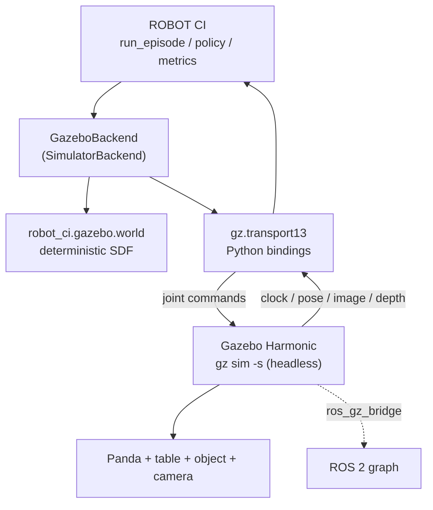

# Gazebo Harmonic as a second simulator backend

This document describes what has actually been built and run, and -- just as
importantly -- what has not. Every claim carries one of four labels:

| Label | Meaning |
|---|---|
| **VERIFIED LIVE** | Executed on a real runtime; the output is committed. |
| **IMPLEMENTED BUT NOT VERIFIED** | Code exists, not run. |
| **UNAVAILABLE** | Cannot run here; the blocker is named. |
| **NOT APPLICABLE** | Out of scope for this backend. |

## 1. Environment (measured, not assumed)

| Property | Value | Established by |
|---|---|---|
| OS (host) | macOS 26.5, `arm64` | `sw_vers`, `uname -m` |
| ROS 2 (host) | **UNAVAILABLE** | `which ros2` -> not found |
| Gazebo (host) | **UNAVAILABLE** | `which gz` -> not found; no gazebo brew formulae |
| ROS 2 (container) | Jazzy, Ubuntu 24.04 | `docker/ros2_gazebo.Dockerfile` |
| Gazebo (container) | Harmonic **8.15.0** | `gz sim --versions` |
| Python / MuJoCo | 3.12.3 / 3.14.0 | container |

**Why Jazzy and not Harmonic's own image.** `pyproject.toml` pins
`requires-python = ">=3.11,<3.13"`. `osrf/ros:harmonic` is Ubuntu 22.04 /
CPython 3.10 and cannot import this package. Jazzy is Ubuntu 24.04 / CPython
3.12, and `ros-jazzy-ros-gz` installs Gazebo Harmonic (gz-sim8) as the default.

## 2. Architecture



Observation: Gazebo -> gz-transport -> `Observation` -> policy.
Command: policy -> `Action` -> gz-transport -> Gazebo joints.

## 3. What exists

| Component | File | Status |
|---|---|---|
| Deterministic SDF world generator | `src/robot_ci/gazebo/world.py` | **VERIFIED LIVE** (loads, 0 errors) |
| Placement from `(seed, scenario_id)` | `object_pose_from_scenario` | **VERIFIED LIVE** (unit tested) |
| Camera intrinsics -> Gazebo FOV (radians) | `_camera_sensor_xml` | **VERIFIED LIVE** (fixed a real load failure) |
| Depth noise / clipping translation | `_camera_sensor_xml` | **VERIFIED LIVE** (unit tested) |
| Unreproducible-condition reporting | `unsupported_conditions` | **VERIFIED LIVE** (unit tested) |
| Unit tests | `tests/unit/test_gazebo_world.py` | **VERIFIED LIVE** (14 passed) |
| ROS 2 Jazzy + Gazebo Harmonic image | `docker/ros2_gazebo.Dockerfile` | **VERIFIED LIVE** (builds; gz 8.15.0) |
| **Panda URDF** | `gazebo/models/panda/panda.urdf` | **VERIFIED LIVE** -- loads into Gazebo with 0 errors |
| Joint command topic for `joint1` | via `JointPositionController` | **VERIFIED LIVE** -- `/model/panda/joint/joint1/0/cmd_pos` exists |
| Simulation clock | Gazebo `/clock` | **VERIFIED LIVE** -- advances |
| Command topics for the other 8 joints | -- | **NOT ESTABLISHED** |
| Joint state feedback topic | -- | **NOT ESTABLISHED** |
| Control -> motion measurement | -- | **NOT VERIFIED** |
| `GazeboBackend(SimulatorBackend)` | -- | **NOT YET WRITTEN** |
| Gazebo episodes / artifacts | -- | **NOT YET RUN** |
| Cross-simulator comparison | -- | **NOT YET PRODUCED** |
| Gazebo launch file | -- | **NOT YET WRITTEN** |

## 3a. The Panda model (VERIFIED LIVE)

`gazebo/models/panda/panda.urdf` is a Franka Emika Panda whose kinematics are
taken from the MuJoCo model this project already validates
(`mujoco/models/franka_emika_panda/panda.xml`), so Gazebo's robot has the same
morphology as the reference rather than an approximation. Joint names are
ROBOT CI's own (`joint1`..`joint7`, `left_finger`, `right_finger`), so the
control path needs no name translation.

Geometry is primitive boxes and cylinders, not the MJCF's STL/OBJ meshes. That
is a recorded trade: the meshes are large binary assets, Gazebo and MuJoCo
collision meshes differ subtly anyway, and a per-link bounding volume is
reproducible and reviewable. It is also a genuine difference between the two
robots and is listed under limitations rather than presented as equivalent.

Three real bugs were found by running Gazebo rather than by reading about it:

1. **Inertia tensors were invalid.** MuJoCo's `fullinertia` ordering is
   `(ixx, iyy, izz, ixy, ixz, iyz)` and the first draft swapped `ixz` with
   `iyz`. Gazebo refused four links with "has invalid inertia". The values are
   now derived from the MJCF programmatically rather than transcribed.
2. **`<include><uri>` is not a filesystem path.** Gazebo resolves it through
   its resource path and answers `Unable to find uri[...]`; it needs a `file://`
   URI, valid *inside the runtime* (which is why a macOS host path fails inside
   the container).
3. **The joint controller must attach to a model, and takes repeated
   `<joint_name>` elements.** In the world it refuses to initialise; inside the
   URDF, `<scoped_joints>` and a `<joint_names>` wrapper both fail with
   "Failed to get any `<joint_name>`".

## 3b. Evidence

`experiments/results/gazebo/evidence_panda_load.txt` and
`evidence_world_load.txt` record the real runs.

## 4. Determinism

* Object placement draws from
  `make_numpy_rng(scenario.seed, "gazebo-scene", scenario.scenario_id)` -- the
  same convention `simulation/mujoco_env.py` uses.
* **`scenario_id` is read, never written.** It participates in placement, so
  renaming a condition to describe a generated artifact moves the target object.
  `test_object_placement_follows_the_scenario_id` pins this.
* Nothing derives randomness from node names, PIDs, entity IDs or wall-clock.
* Physics runs at a fixed 1 ms `max_step_size`, matching the control rate.

**Not claimed:** bit-identical trajectories across MuJoCo and Gazebo. The engines
integrate differently, so the same action sequence yields different joint
trajectories. Cross-simulator *scenario-level* determinism -- same seed to same
placement, same config hash -- is what is claimed and tested.

## 5. Reproducing what is verified

```bash
docker build -f docker/ros2_gazebo.Dockerfile -t robot-ci-ros2-gazebo:jazzy .

# Generate a world from the project's own scenario
python -c "from robot_ci.gazebo import world_sdf; from robot_ci.scenarios import default_scenario; \
           open('/tmp/world.sdf','w').write(world_sdf(default_scenario()))"

# Load it in headless Gazebo and list what it publishes
docker run --rm -v /tmp:/gz robot-ci-ros2-gazebo:jazzy bash -lc \
  'export PATH=/opt/ros/$ROS_DISTRO/bin:$PATH; source /opt/ros/$ROS_DISTRO/setup.bash;
   (timeout 15 gz sim -s -r /gz/world.sdf &); sleep 12; gz topic -l'
```

## 6. Limitations and blockers

* **Only one of nine joints is commandable.** The
  `JointPositionController` resolves a single `<joint_name>` from the URDF, so
  `/model/panda/joint/joint1/0/cmd_pos` exists and `joint2`..`joint7` plus the
  fingers do not. This is the immediate blocker: it is a controller
  configuration question, not a physics one, and it must be resolved before any
  episode can be commanded.
* **No joint-state feedback topic observed.** The state topic the adapter would
  read back has not been located, so joint positions are not yet proven to
  return to ROBOT CI.
* **Collision geometry differs from MuJoCo.** The URDF uses per-link primitive
  bounding volumes where the MuJoCo model uses meshes. Contact response is
  therefore *expected* to differ between the two simulators, which is a real
  source of cross-simulator disagreement rather than a defect.
* **`GazeboBackend` is not written.** No claim of a working Gazebo backend is
  made. The world generator and the robot model are finished and verified; the
  control and observation adapter between them and `SimulatorBackend` is not.
* **No episode has been run in Gazebo.** There is therefore **no** Gazebo result
  for either condition, and no cross-simulator comparison table. The MuJoCo
  reference it would be compared against is committed: 0 mm -> success (76
  steps), 8 mm -> failure (85 steps).
* **Headless only.** Gazebo runs with `-s` (server, no GUI). The GUI is never
  required by an experiment, so this limits interactive inspection only.
* **Sensor parity is partial by construction.** Gazebo has no per-frame
  dropout, occlusion injector or blur stage; `unsupported_conditions` names each
  gap rather than dropping it silently.

## 7. What would make this runtime-verified

1. Get all nine joints commandable -- most likely by scoping the controller
   from the world against the included model, or by driving the joints through
   `JointController` `cmd_pos` topics directly.
2. Locate the joint-state feedback topic and confirm positions come back.
3. Implement `GazeboBackend(SimulatorBackend)` over `gz.transport13`: joint
   commands on `/model/panda/joint/<joint>/cmd`, state from
   `/world/.../dynamic_pose/info`, images from the camera topics, `/clock` as
   the authoritative simulation clock.
4. Run seed 3 at 0 mm and at 8 mm; record both artifacts.
5. Compare against the MuJoCo reference **without adjusting anything to make
   them agree**. A disagreement is the finding, not a defect to tune away.
