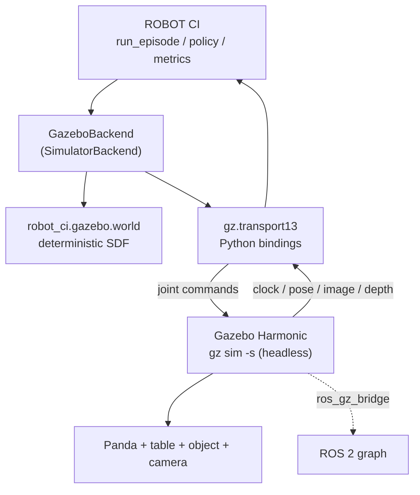

# Gazebo Harmonic as a second simulator backend

This document describes what has actually been built and run, and -- just as
importantly -- what has not. Every claim carries one of four labels:

| Label | Meaning |
|---|---|
| **VERIFIED LIVE** | Executed on a real runtime; the output is committed. |
| **IMPLEMENTED BUT NOT VERIFIED** | Code exists, not run. |
| **UNAVAILABLE** | Cannot run here; the blocker is named. |
| **NOT APPLICABLE** | Out of scope for this backend. |

## 1. Environment (measured, not assumed)

| Property | Value | Established by |
|---|---|---|
| OS (host) | macOS 26.5, `arm64` | `sw_vers`, `uname -m` |
| ROS 2 (host) | **UNAVAILABLE** | `which ros2` -> not found |
| Gazebo (host) | **UNAVAILABLE** | `which gz` -> not found; no gazebo brew formulae |
| ROS 2 (container) | Jazzy, Ubuntu 24.04 | `docker/ros2_gazebo.Dockerfile` |
| Gazebo (container) | Harmonic **8.15.0** | `gz sim --versions` |
| Python / MuJoCo | 3.12.3 / 3.14.0 | container |

**Why Jazzy and not Harmonic's own image.** `pyproject.toml` pins
`requires-python = ">=3.11,<3.13"`. `osrf/ros:harmonic` is Ubuntu 22.04 /
CPython 3.10 and cannot import this package. Jazzy is Ubuntu 24.04 / CPython
3.12, and `ros-jazzy-ros-gz` installs Gazebo Harmonic (gz-sim8) as the default.

## 2. Architecture



Observation: Gazebo -> gz-transport -> `Observation` -> policy.
Command: policy -> `Action` -> gz-transport -> Gazebo joints.

## 3. What exists

| Component | File | Status |
|---|---|---|
| Deterministic SDF world generator | `src/robot_ci/gazebo/world.py` | **VERIFIED LIVE** (loads, 0 errors) |
| Placement from `(seed, scenario_id)` | `object_pose_from_scenario` | **VERIFIED LIVE** (unit tested) |
| Camera intrinsics -> Gazebo FOV (radians) | `_camera_sensor_xml` | **VERIFIED LIVE** (fixed a real load failure) |
| Depth noise / clipping translation | `_camera_sensor_xml` | **VERIFIED LIVE** (unit tested) |
| Unreproducible-condition reporting | `unsupported_conditions` | **VERIFIED LIVE** (unit tested) |
| Unit tests | `tests/unit/test_gazebo_world.py` | **VERIFIED LIVE** (14 passed) |
| ROS 2 Jazzy + Gazebo Harmonic image | `docker/ros2_gazebo.Dockerfile` | **VERIFIED LIVE** (builds; gz 8.15.0) |
| `GazeboBackend(SimulatorBackend)` | -- | **NOT YET WRITTEN** |
| Panda URDF | -- | **NOT YET SUPPLIED** |
| rosbag / launch / artifact scripts | -- | **NOT YET WRITTEN** |

### Evidence (VERIFIED LIVE)

`experiments/results/gazebo/evidence_world_load.txt` records a real run. The
generator's SDF loaded in headless Gazebo and published:

```
/world/robot_ci_pick_place/model/camera_rig/link/link/sensor/robot_ci_camera/camera_info
/world/robot_ci_pick_place/model/camera_rig/link/link/sensor/robot_ci_camera/depth_image
/world/robot_ci_pick_place/model/camera_rig/link/link/sensor/robot_ci_camera/image
/world/robot_ci_pick_place/model/camera_rig/link/link/sensor/robot_ci_camera/points
/clock
```

with **0** SDF validation errors.

That run substituted a placeholder for the robot, because no Panda URDF exists
in this environment. The *world* is the generator's output and is verified; the
robot is not.

## 4. Determinism

* Object placement draws from
  `make_numpy_rng(scenario.seed, "gazebo-scene", scenario.scenario_id)` -- the
  same convention `simulation/mujoco_env.py` uses.
* **`scenario_id` is read, never written.** It participates in placement, so
  renaming a condition to describe a generated artifact moves the target object.
  `test_object_placement_follows_the_scenario_id` pins this.
* Nothing derives randomness from node names, PIDs, entity IDs or wall-clock.
* Physics runs at a fixed 1 ms `max_step_size`, matching the control rate.

**Not claimed:** bit-identical trajectories across MuJoCo and Gazebo. The engines
integrate differently, so the same action sequence yields different joint
trajectories. Cross-simulator *scenario-level* determinism -- same seed to same
placement, same config hash -- is what is claimed and tested.

## 5. Reproducing what is verified

```bash
docker build -f docker/ros2_gazebo.Dockerfile -t robot-ci-ros2-gazebo:jazzy .

# Generate a world from the project's own scenario
python -c "from robot_ci.gazebo import world_sdf; from robot_ci.scenarios import default_scenario; \
           open('/tmp/world.sdf','w').write(world_sdf(default_scenario()))"

# Load it in headless Gazebo and list what it publishes
docker run --rm -v /tmp:/gz robot-ci-ros2-gazebo:jazzy bash -lc \
  'export PATH=/opt/ros/$ROS_DISTRO/bin:$PATH; source /opt/ros/$ROS_DISTRO/setup.bash;
   (timeout 15 gz sim -s -r /gz/world.sdf &); sleep 12; gz topic -l'
```

## 6. Limitations and blockers

* **No Panda URDF is available.** The repository ships the Franka model as
  MuJoCo XML only (`mujoco/models/franka_emika_panda/`), and the container's apt
  sources carry no `franka`/`panda` description package. Gazebo needs a URDF.
  The placeholder used for the evidence run is not a robot and is not presented
  as one.
* **`GazeboBackend` is not written.** No claim of a working Gazebo backend is
  made. The world generator is finished and verified; the control and
  observation adapter between it and `SimulatorBackend` is not.
* **No episode has been run in Gazebo.** There is therefore **no** Gazebo result
  for either condition, and no cross-simulator comparison table. The MuJoCo
  reference it would be compared against is committed: 0 mm -> success (76
  steps), 8 mm -> failure (85 steps).
* **Headless only.** Gazebo runs with `-s` (server, no GUI). The GUI is never
  required by an experiment, so this limits interactive inspection only.
* **Sensor parity is partial by construction.** Gazebo has no per-frame
  dropout, occlusion injector or blur stage; `unsupported_conditions` names each
  gap rather than dropping it silently.

## 7. What would make this runtime-verified

1. Add a Panda URDF (Franka description, or one authored to match the MuJoCo
   model's morphology) and confirm it loads.
2. Implement `GazeboBackend(SimulatorBackend)` over `gz.transport13`: joint
   commands on `/model/panda/joint/<joint>/cmd`, state from
   `/world/.../dynamic_pose/info`, images from the camera topics, `/clock` as
   the authoritative simulation clock.
3. Run seed 3 at 0 mm and at 8 mm; record both artifacts.
4. Compare against the MuJoCo reference **without adjusting anything to make
   them agree**. A disagreement is the finding, not a defect to tune away.
