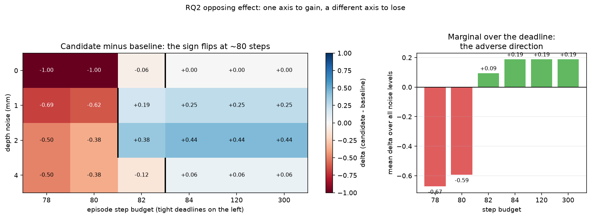
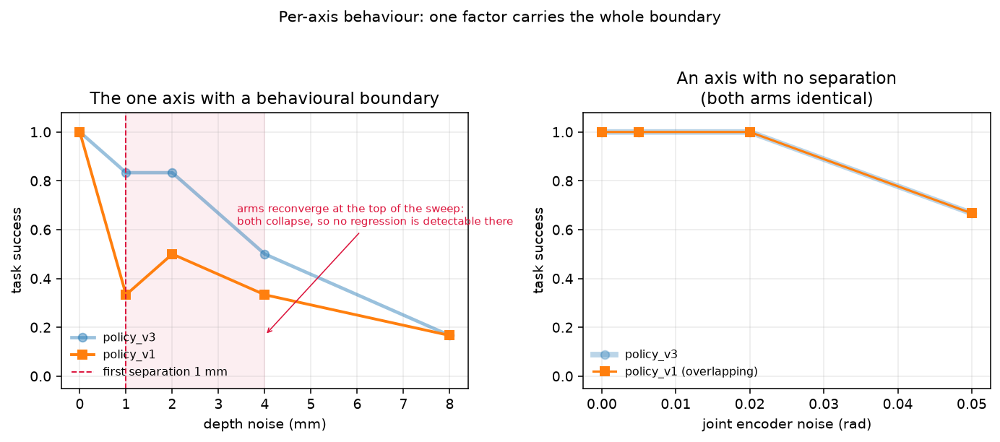

# Robot CI: research report (generated)

Generated 2026-10-01 10:21 UTC by `experiments/make_research_report.py` from the artifacts in `experiments/results/`. Every number below is read from those files; none is transcribed.

This file is machine-generated and therefore never stale with respect to the runs. The hand-written `research_report.md` carries the narrative, the method and the limitations, and is the document to read for those.

## Verification state

Record at commit `20d8d91`, overall **0**.

| check | exit |
|---|---|
| ruff (src, tests, experiments) | 0 |
| ruff format --check | 1 |
| mypy (src/robot_ci) | 0 |
| unit | 0 |
| integration | 0 |
| end to end | 0 |
| robot-ci validate | 0 |
| package imports without mujoco | 0 |

Exit codes, not output text. See `docs/verification.md` for the two failures of the verification process itself that this rule was adopted to fix.

## Nominal solvability (a corrected figure)

**The previously published claim of 66.7% is falsified.** It was an
8/12 measurement taken before the IK-tolerance and object-spawn fixes,
and it was written in the present tense as a standing property. It is
now measured over many seeds, with an interval.

| policy | success | rate | 95% Wilson CI | steps (mean) | steps (range) |
|---|---|---|---|---|---|
| `policy_v1` | 120/120 | 1.000 | [0.969, 1.000] | 76.4 | 76-78 |
| `policy_v2` | 120/120 | 1.000 | [0.969, 1.000] | 76.4 | 76-78 |
| `policy_v3` | 120/120 | 1.000 | [0.969, 1.000] | 81.4 | 81-83 |

Over 120 seeds the baseline solves the nominal task **120/120** times, with a 95% lower bound of **96.9%**. The old 66.7% lies far below that interval, so it is falsified rather than imprecise.

This matters beyond bookkeeping. The report had drawn a conclusion from
the old number -- that a real 10% regression could hide inside a 33%
failure floor. With a floor near zero that limitation does not exist,
and the framework's sensitivity is not bounded by its benchmark.
A stale number had propagated into a stated limitation.

It also supplies the measurement the RQ2 design needed: the candidate spends 5.0 extra control ticks per episode, which is invisible against the default 300-step budget and decisive against a deadline near the real cost.

## RQ2: the opposing-effect experiment

Arms `policy_v1` (baseline) against `policy_v3` (candidate), over a 4 x 6 grid with 16 seeds per cell.

The candidate averages pose samples before committing. Two axes, chosen so that its benefit and its cost cannot be separated by a one-dimensional sweep: **depth noise**, which its averaging suppresses, and the **step budget**, a deadline that its extra settling ticks must fit inside.

Positive cells: **11**. Negative cells: **10**. Aggregate: **-0.102**.

| depth noise | budget 78 | budget 80 | budget 82 | budget 84 | budget 120 | budget 300 |
|---|---|---|---|---|---|---|
| 0 mm | -1.00 | -1.00 | -0.06 | +0.00 | +0.00 | +0.00 |
| 1 mm | -0.69 | -0.62 | +0.19 | +0.25 | +0.25 | +0.25 |
| 2 mm | -0.50 | -0.38 | +0.38 | +0.44 | +0.44 | +0.44 |
| 4 mm | -0.50 | -0.38 | -0.12 | +0.06 | +0.06 | +0.06 |

**The sign flips inside every noise row**, at the same place: the candidate is destroyed at a budget of 80 and wins from 82 upward. That is not fitted. It is where the step measurement puts it: the candidate needs 81 steps at nominal and the baseline needs 76.

The aggregate is **-0.102** while the grid contains a +0.44 cell and a -1.00 cell. The aggregate understates the worst condition by a factor of 10.

**The asymmetry is the finding, and it is not a near-tie.** A realistic grid would want the two channels to cancel; these do not, and the reason is structural. The candidate's benefit is *graded* -- it recovers part of a success rate -- while its cost is *categorical*: miss the deadline and the episode scores zero regardless of how much noise was suppressed. Graded gains cannot average away a cliff.

**And the aggregate is not a population estimate.** It is the mean over a designed grid that deliberately brackets the boundary, which places two of six budget levels below it. Averaging over a bracketing grid counts the same physical failure several times. That is the caution this exercise supports: an aggregate summarises the conditions someone chose to run, and RQ2's point is that those choices should be visible rather than implicit.

## The end-to-end demonstration

One command, `experiments/run_end_to_end.py`, running the whole chain against fresh episodes rather than against the recorded artifacts. It reproduced every previously recorded finding independently, which is the check that matters: the earlier numbers were not produced by a process that only works once.

Arms `policy_v1` (baseline) and `policy_v3` (candidate), differing in one subsystem (perception).

The demo grid varies two axes because that is what the question needs: depth noise, which the candidate's averaging suppresses, and a step budget, which refuses the candidate's extra settling ticks. One command therefore has to demonstrate both the regression and the improvement, rather than asserting one from a previous artifact and the other from another.

### Table 4a: the grid as run (eight separate condition cells)

These are the counts the matrix stage recorded, before any detector grouping. Each row below is a different `scenario_id`: noise and budget are both part of the identity, so no row averages two kinds of episode.

| depth noise | step budget | baseline | candidate | delta |
|---|---|---|---|---|
| 0 mm | 80 | 0.17 | 0.00 | -0.17 |
| 0 mm | 300 | 1.00 | 1.00 | +0.00 |
| 1 mm | 80 | 0.33 | 0.00 | -0.33 |
| 1 mm | 300 | 0.83 | 1.00 | +0.17 |
| 2 mm | 80 | 0.17 | 0.00 | -0.17 |
| 2 mm | 300 | 0.50 | 1.00 | +0.50 |
| 4 mm | 80 | 0.00 | 0.50 | +0.50 |
| 4 mm | 300 | 0.00 | 0.00 | +0.00 |

### Table 4b: what the unmodified framework detector reports

The detector groups episodes by the values in `EpisodeResult.conditions`. Because the eight grid cells use distinct `scenario_id` values, the shipped comparison keeps all eight separate without any code change: the detector's own grouping, labels, confidence intervals, and blocking findings below come from `compare_conditions`, not from a parallel implementation.

| detector label | baseline | candidate | delta | 95% CI (candidate) |
|---|---|---|---|---|
| nominal__depth_noise_mm=0__max_steps=300 | 1.00 | 1.00 | +0.00 | [0.61, 1.00] |
| nominal__depth_noise_mm=0__max_steps=80 | 0.17 | 0.00 | -0.17 | [0.00, 0.39] |
| nominal__depth_noise_mm=1__max_steps=300 | 0.83 | 1.00 | +0.17 | [0.61, 1.00] |
| nominal__depth_noise_mm=1__max_steps=80 | 0.33 | 0.00 | -0.33 | [0.00, 0.39] |
| nominal__depth_noise_mm=2__max_steps=300 | 0.50 | 1.00 | +0.50 | [0.61, 1.00] |
| nominal__depth_noise_mm=2__max_steps=80 | 0.17 | 0.00 | -0.17 | [0.00, 0.39] |
| nominal__depth_noise_mm=4__max_steps=300 | 0.00 | 0.00 | +0.00 | [0.00, 0.39] |
| nominal__depth_noise_mm=4__max_steps=80 | 0.00 | 0.50 | +0.50 | [0.19, 0.81] |

Both tables agree because the condition actually varied is present in the scenario identity the detector already groups on. Earlier in this project the same detector, grouping only on the values present in `conditions`, pooled distinct cells into one label when an in-place sweep left `scenario_id` unchanged -- a conditional analysis that conditioned on nothing. Naming each grid cell here is the minimal setup that lets the shipped detector keep them apart.

Aggregate **+0.062** against a worst cell of **-0.333**, with **3** blocking finding(s): `nominal__depth_noise_mm=1__max_steps=80` (-0.33), `nominal__depth_noise_mm=0__max_steps=80` (-0.17), `nominal__depth_noise_mm=2__max_steps=80` (-0.17)

The aggregate is small because the candidate's favourable and adverse cells have opposite signs, not because the candidate changed little. Table 4a shows the cancellation explicitly: timeouts on one budget, noise suppression on the other.

## Aggregate and conditional metrics

Arms `policy_v3` (baseline) and `policy_v1` (candidate), 8 seeds x 5 conditions.

| depth noise | baseline | candidate | delta |
|---|---|---|---|
| 0 mm | 1.00 | 1.00 | +0.00 |
| 1 mm | 0.88 | 0.50 | -0.38 |
| 2 mm | 0.88 | 0.50 | -0.38 |
| 4 mm | 0.62 | 0.25 | -0.38 |
| 8 mm | 0.25 | 0.12 | -0.12 |

Aggregate over 40 runs: **-0.250** (baseline 0.725, candidate 0.475).

Worst conditional cell: **-0.375**. The aggregate reports 67% of the severity of the worst condition it averages over, and 4 cells cross the blocking threshold.

## Counterexample search

Budget 24 oracle evaluations each, seed 3.

| strategy | evals | wall clock | counterexample | minimal |
|---|---|---|---|---|
| grid | 2 | 4.4 s | 4.00 mm | no |
| random | 1 | 1.4 s | 7.64 mm | no |
| binary | 8 | 17.1 s | 1.17 mm | yes |
| adaptive | 15 | 26.0 s | 1.17 mm | yes |

Random finds a counterexample in 1 evaluation against adaptive's 15, but needs 6.5x the perturbation to reproduce. **Tests-to-failure alone ranks random best, and that is the wrong answer.** One trial per strategy on one axis and one seed: this shows the trade-off, not that a strategy is better.

## Counterexample reproducibility

Counterexample `{'depth_noise_mm': 2.0}` replayed on 11 seeds disjoint from the discovery seed (3).

**Reproduction rate: 3/11 = 27.3%**

a rate well below 1.0 means the counterexample is a property of the discovery seed as much as of the condition. It must not be reported as a behavioural boundary without this number attached.

## Behavioural boundaries

Axes with a located boundary: `{'depth_noise_mm': 1.0}`.

Axes with no separation: 6 — `['depth_bias_mm', 'occlusion_percent', 'joint_noise_rad', 'latency_ms', 'clutter_count', 'object_friction']`.

## Failure-injection benchmark

20 benchmarks, **0 expectation mismatches**, 8 with a measured expectation and 12 labelled hypotheses.

| benchmark | family | success | expectation | basis |
|---|---|---|---|---|
| perception_blur | perception | 1.00 | met | hypothesis |
| perception_occlusion | perception | 1.00 | met | hypothesis |
| perception_low_light | perception | 1.00 | met | hypothesis |
| perception_colour_shift | perception | 1.00 | met | hypothesis |
| depth_noise | depth | 0.00 | met | measured |
| depth_bias | depth | 0.00 | met | measured |
| depth_dropout | depth | 1.00 | met | hypothesis |
| depth_latency | depth | 1.00 | met | hypothesis |
| camera_latency | camera | 1.00 | met | measured |
| camera_extrinsic_error | camera | 1.00 | met | hypothesis |
| camera_intrinsic_error | camera | 1.00 | met | hypothesis |
| robot_joint_offset | robot | 1.00 | met | measured |
| robot_joint_noise | robot | 0.67 | met | measured |
| robot_encoder_delay | robot | 1.00 | met | hypothesis |
| environment_object_displacement | environment | 0.83 | met | measured |
| environment_clutter | environment | 1.00 | met | measured |
| environment_obstacle | environment | 0.00 | met | hypothesis |
| environment_friction | environment | 1.00 | met | measured |
| planning_wrong_target | planning | 0.00 | met | hypothesis |
| planning_blocked_path | planning | 1.00 | met | hypothesis |

Faults recorded as **not effective** rather than approximated:

- `perception_wrong_label` — No class-confusion model; object category is fixed by the scenario.
- `planning_stale_world_model` — The policy re-reads its own object belief each tick rather than a cached world model, so there is no staleness to inject.
- `depth_quantization` — Field exists in the sensor model but is not yet wired into the corruption application.
- `robot_gripper_stuck` — The field exists and the corruption arms correctly, but nothing applies it: measured at 1.0, zero of seven metrics move against nominal. The suite found this by falsifying the benchmark's own expectation, which is the clearest argument for a suite that checks its predictions.

## Attribution, scored against injected ground truth

`policy_v3` and `policy_v1` differ in exactly one subsystem: **perception**.

| method | implicated | episodes | correct |
|---|---|---|---|
| correlation_only | planner | 12 | **no** |
| ofat | perception | 216 | yes |
| interaction_aware | perception | 216 | yes |

OFAT and interaction-aware analysis both recover the injected cause; correlation-only analysis does not

## Falsified, withdrawn and unresolved

The results above are the ones that worked. These are not, and they are the more useful half of the record.

**Falsified by measurement, not by argument:**

* *Camera latency and RGB occlusion are behavioural factors.* Measured flat at 1.00 across 0-200 ms and 0-60%. The policy latches its plan on the first control tick and never reads RGB. Sweeping them costs episodes to measure nothing.
* *Depth bias is survivable.* A 2 mm systematic offset takes both arms to 0.00 while 1 mm of Gaussian noise still leaves the baseline at 0.67. Averaging removes noise; it cannot remove bias. A benchmark sweeping only Gaussian noise would conclude perception is robust to depth error, which is false.
* *The failing grasp is an aiming problem.* End-effector distance to the object does not predict success: failures at 1.4 mm and 2.2 mm, successes at 2.2 mm and 2.4 mm. Also tested and rejected: lift shear (halving joint velocity changes nothing) and grip width (0.6 worse, 0.75/0.8/0.9 identical to the 0.7 default).

**Withdrawn after re-running:**

* *Joint-encoder noise changes the sign of the effect along its axis* and *object friction is non-monotonic*. Both were artefacts of a loose 2 mm IK tolerance and both are flat after it was tightened. A measurement that changes when an unrelated constant changes was never a measurement of the policy.

**Resolved since the previous revision:**

* *Nominal solvability is 66.7%, so a real 10% regression could hide inside a 33% failure floor.* **Falsified by measurement.** It was an 8/12 sample from before the IK-tolerance and spawn fixes, written in the present tense. Over 120 seeds the baseline solves nominal 120/120, with a 95% lower bound of 96.9%. There is no 33% floor and the stated limitation does not exist. A stale number had propagated into a limitation on the framework's own sensitivity -- the same failure mode the framework exists to detect.
* *The strong form of RQ2 is not demonstrated.* **Demonstrated, with a qualification.** The sign of the candidate's effect flips inside every row of a noise-by-deadline grid, and the aggregate understates the worst cell by an order of magnitude. It is not a near-tie, and the reason is structural: a graded benefit cannot average away a categorical cost.

**Unresolved, and load-bearing:**

* *RQ1 is one trial per strategy on one axis and one seed.*
* *The pairwise ablation design is untested on the only case it exists for*: a regression with a genuine two-factor interaction. None has been constructed.
* *RQ2's adverse channel is a deadline, not the mechanism its own docstring predicted.* The prediction named latency; latency is inert, so a step budget had to substitute. Whether the same inversion appears under a *perceptual* adverse channel is untested, because none exists here: objects cannot move, and averaging only costs you when the averaged quantity changes.
* *The RQ2 aggregate is a mean over a boundary-bracketing grid*, not a population estimate, and it is reported as such.

## Not verified here

* Isaac Sim adapter — **implemented but unverified**; no macOS build, never executed.
* ROS 2 and MoveIt 2 — **not started**; `ros2_ws/src/` holds three empty directories.
* Notebooks and cloud execution — **not started**.
* The Linux CI workflow — **written, never run**.

See `docs/verification.md` for the full verified/unverified split.
